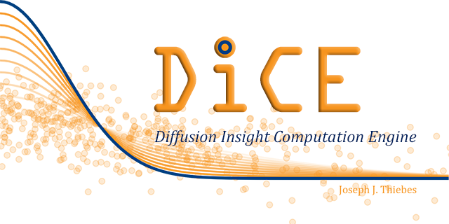

# Diffusion Insight Computation Engine (DICE)



[Download the latest release on Zenodo](https://doi.org/10.5281/zenodo.10258191) | [GitHub repository](https://github.com/thiebes/DICE)

[](https://doi.org/10.5281/zenodo.10258191)

DICE is an open-source tool for researchers in time-resolved microscopy and related fields. It evaluates the precision and accuracy of diffusion coefficient estimates derived from optical measures of excited state transport. DICE simulates measurements with parameters that match your experimental setup and reports how the estimates of the diffusion coefficient are distributed.

DICE was developed alongside research that the tool was used to perform, published in the following paper:

Joseph J. Thiebes, Erik M. Grumstrup; Quantifying noise effects in optical measures of excited state transport. J. Chem. Phys. 28 March 2024; 160 (12): 124201. [https://doi.org/10.1063/5.0190347](https://doi.org/10.1063/5.0190347).

## What Does DICE Do?

DICE estimates how precise and how accurate a diffusion coefficient measurement can be with your experimental parameters, such as the initial spot width, the nominal diffusion length, and the initial contrast-to-noise ratio (CNR). It simulates many measurements with these parameters and estimates the diffusion coefficient from each one. It then reports the standard deviation, relative standard error, bias, and root-mean-square error (RMSE) of the estimates.

DICE also reports the fraction of estimates within a chosen proximity of the nominal value, for example: "50% of the diffusion coefficient estimates are within ±10% of the nominal value." That fraction estimates the probability that one measurement with your parameters reaches the accuracy and precision that your investigation requires. You choose the proximity level when you analyze the results, after the simulation. The summary file reports ±5%, ±10%, ±20%, and ±50%. In the GUI, you can choose any level from 1% to 50%.

### How it works

1. **Generation of time-series profiles:** DICE simulates a population of excited states as a Gaussian profile that diffuses and decays. The initial profile has an amplitude (usually 1), a width given as the full width at half maximum (FWHM) or the standard deviation, a mean position (usually zero), and a baseline of zero.
2. **Noise addition:** DICE adds white noise to the profiles. The noise has the same standard deviation at every time point. You give the standard deviation directly, or DICE derives it from a measured profile with the [fft-cnr](https://pypi.org/project/fft-cnr/) package. With a noise range, each run draws its own standard deviation, so one simulation covers a range of CNR.
3. **Gaussian fit:** DICE fits a Gaussian function to each noisy profile. The change of the fitted variance over time gives the mean squared displacement (MSD).
4. **Linear fit and diffusion coefficient estimation:** DICE fits the variance against time with two linear fits, weighted least squares (WLS) and ordinary least squares (OLS). In one dimension, the slope of the fit is twice the estimated diffusion coefficient.
5. **Analysis:** DICE compares the estimated diffusion coefficients with the nominal diffusion coefficient that generated the profiles. Because it repeats the simulation many times with the same parameters, the estimates form a distribution that shows the precision and accuracy of the measurement.
6. **Presentation:** DICE writes a results file, a summary, and a histogram of the estimates. With a noise range, the summary reports the statistics for bins of initial CNR, and a scatter plot of the estimates against the initial CNR replaces the histogram.

## Quick Start

### Option 1: Graphical user interface (GUI), recommended for new users

1. **Install uv**, a Python package and project manager. For example, run `winget install --id=astral-sh.uv -e` on Windows or `brew install uv` on macOS. The [Installation Guide](docs/installation.md#install-uv) lists other methods.

2. **Clone and run:**

   ```bash
   git clone https://github.com/thiebes/DICE.git
   cd DICE
   uv sync
   uv run dice-gui
   ```

The GUI organizes the parameters in tabs, checks each input as you type, has a unit selector for each input with a length or time dimension, and computes related quantities, such as the diffusion length from D and τ.

See the [GUI Guide](dice_gui/README.md) for details.

### Option 2: Command line

For batch processing and scripts, use the command-line interface (CLI). After the installation above, run a parameters file, for example one of the examples in `data/examples/`:

```bash
uv run dice data/examples/parameters.txt
```

See the [CLI Guide](docs/cli-guide.md) for details and the [Parameter Reference](docs/parameters.md) for all parameters.

### Option 3: Online CNR estimator

The [online CNR estimator](https://dice-thiebes.pythonanywhere.com) estimates the CNR of a one-dimensional noisy profile with the fft-cnr package. It needs no Python installation.

## Documentation

- **[Installation Guide](docs/installation.md)** - Detailed installation instructions for all methods
- **[Parameter Reference](docs/parameters.md)** - Complete parameter documentation
- **[CLI Guide](docs/cli-guide.md)** - Command-line usage and examples
- **[GUI Guide](dice_gui/README.md)** - Graphical interface documentation
- **[Glossary](docs/glossary.md)** - Technical terms and acronyms
- **[Contributing](CONTRIBUTING.md)** - How to contribute to DICE

## Installation

The [Installation Guide](docs/installation.md) covers:

- [installation with uv](docs/installation.md#install-with-uv-recommended), the recommended method shown above
- [installation with pip](docs/installation.md#install-with-pip), including an editable installation for development
- [optional extras](docs/installation.md#optional-extras) for the web app and the tests
- [troubleshooting](docs/installation.md#troubleshooting)

## Outputs

DICE writes three output files to `output/<filename_slug>/`:

- **Summary text file** (`<slug>_summary.txt`): the main parameters and the statistics of the estimates
- **Results CSV file** (`<slug>.csv`): the results of every run, for further analysis
- **Histogram plot** (`<slug>_accuracy_histogram.png`): the distribution of the ratio of estimated to nominal diffusion coefficient

The [CLI Guide](docs/cli-guide.md#output-files) describes the contents of each file.

## Interpreting Results

A simulation gives a distribution of diffusion coefficient estimates for one set of parameters. Compare a measured value with this distribution to judge whether the measurement is typical of the values that repeated experiments with the same parameters would give.

You enter either a diffusion coefficient and a lifetime, or a diffusion length. The diffusion coefficient of the sample is unknown, so the nominal value is a best guess or an earlier measurement.

The results show the range of estimates that experiments would give if the nominal values and the other parameters were correct. A simulation cannot test whether those values are correct.

## Known Issues and Limitations

- A measured profile for CNR estimation must be a single line of comma-separated values.
- DICE fits Gaussian functions only.
- Profiles are one-dimensional.
- DICE models normal (Fickian) diffusion only. Anomalous diffusion, such as subdiffusion, is not modeled.
- Diffusion is isotropic. Anisotropic diffusion is not modeled.
- The lifetime model is a single-exponential decay.

## Acknowledgements

Thanks to Professor Erik M. Grumstrup, Skyler Hollinbeck, Sajia Afrin, and my spouse, Julia K. Thiebes, for their invaluable support and feedback.

This material is based upon work supported by the National Science Foundation under Grant No. 2154448. Any opinions, findings, and conclusions or recommendations expressed in this material are those of the author(s) and do not necessarily reflect the views of the National Science Foundation.

## How to Cite

```text
Thiebes, J. J. (2023). Diffusion Insight Computation Engine (DICE) [Software]. Zenodo. https://doi.org/10.5281/zenodo.10258191
```

## License

Diffusion Insight Computation Engine (DICE) by [Joseph J. Thiebes](http://thiebes.org) is licensed under the [MIT License](https://opensource.org/licenses/MIT).

Copyright (c) 2023-2026 Joseph J. Thiebes

Permission is hereby granted, free of charge, to any person obtaining a copy of this software and associated documentation files (the "Software"), to deal in the Software without restriction, including without limitation the rights to use, copy, modify, merge, publish, distribute, sublicense, and/or sell copies of the Software, and to permit persons to whom the Software is furnished to do so, subject to the following conditions:

The above copyright notice and this permission notice shall be included in all copies or substantial portions of the Software.

The full license text, including the warranty disclaimer, is in [LICENSE.md](LICENSE.md).

The GUI uses PyQt6, which is licensed under the GNU General Public License (GPL) version 3. The standalone applications of a release contain PyQt6, so they are distributed under the GPL version 3. Each one carries a notice with the license text of every package it contains; see [Licenses](docs/installation.md#licenses) in the installation guide.
